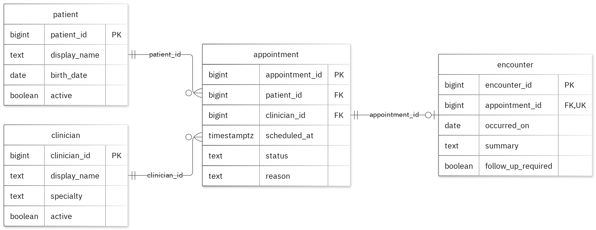

# MIT 8103 Advanced Database Systems

**LaurineCare Hospital - Hospital / Clinic System** · Obehi Aizenabor · Student ID 301915793

## Case study

My case study is LaurineCare Hospital, a Hospital / Clinic System. I designed the database for clinic schedulers, clinicians, and clinic administrators, using separate tables named patient, clinician, appointment, and encounter. The system supports core clinical operations, including registering patients and clinicians, scheduling, rescheduling, or cancelling appointments, and recording encounter summaries.

## Portfolio 1: Database Design and Modelling

I organised the relational design into four distinct tables, using primary keys to identify records, foreign keys to preserve entity links, and check constraints to enforce the core business rules. To prevent a clinician from having two appointments at the same timestamp when the status is scheduled or confirmed, I implemented a partial unique key on clinician_id and scheduled_at filtered to those specific statuses. The normalisation examples illustrate the sample data progressing through 1NF, 2NF, and 3NF, and all 29 deliberately invalid insert attempts were successfully rejected without altering the valid sample rows.

Figure 1. Tables, keys and relationships. PK: primary key; FK: foreign key; UK: unique value.

<!-- PAGE BREAK -->

## Portfolio 2: Query Processing and Optimisation

I executed three SQL queries against the sample records, where the join query returned two rows featuring Avery Sample alongside Morgan Demo. For the index comparison, I tested against 20,000 separate performance rows, reducing the median lookup time from 1.042 ms to 0.173 ms. Both testing phases returned identical records, and the measured execution plan confirmed that the query used the newly created index. Note that these timing benchmarks are specific to this lookup pattern and test environment.

## Portfolio 3: Transactions and Concurrency

I used a temporary counter on appointment to test COMMIT, ROLLBACK, and READ COMMITTED isolation. Uncommitted updates remained hidden from the concurrent session, and ROLLBACK properly restored the previous committed value. Without row-level locking, two concurrent increments resulted in a final counter value of 2 due to a lost update. However, using SELECT FOR UPDATE forced Session B to wait for Session A to commit, preserving both updates and reaching the expected final value of 3. This temporary helper column was strictly confined to the concurrency exercise, leaving the case study's original business fields completely unchanged.

## Portfolio 4: NoSQL and Advanced Data Models

I used the clinic_events collection to store the case's event documents. MongoDB inserted four sample events and returned the expected outputs across four test queries. Schema validation properly rejected both an invalid date type and a duplicate event ID. Embedding snapshots keeps related details directly with each event, while allowing the details field to vary based on the specific event type. Although these are fictional events for testing, PostgreSQL continues to enforce its core relational rules alongside the document store.

## Repository and evidence

https://github.com/oaizenabor5793-hub/Aizenabor_Obehi_301915793

The portfolio folders contain the SQL and JavaScript, explanations, query plans, result tables and screenshots.

<!-- PAGE BREAK -->

## Portfolio 5: Distributed and Cloud Database Exercise

I proposed a three-member MongoDB replica set distributed across separate failure zones. The discussion addresses primary elections, majority write acknowledgements, secondary replication lag, and sharding trade-offs for the clinic_events collection. While replication maintains high availability, dedicated backups handle point-in-time recovery, and PostgreSQL requires its own separate availability strategy. This aligns with the permitted architecture discussion option, as no live replica set or failover test was deployed.

## Individual reflection

To maintain data integrity and eliminate redundancy, I organized patients, clinicians, appointments, and encounters into distinct, normalized tables. To ensure a clinician cannot have two appointments at the same timestamp when the status is scheduled or confirmed, I enforced this with a partial unique key on clinician_id and scheduled_at for those specific statuses. The constraint tests verify this rule alongside all required values and record links. One issue highlighted by the two-session exercise is that both sessions can read the same value before either update is committed. Locking the row before reading successfully preserves both increments. Additionally, the index comparison showed why I need to inspect the execution plan as well as the final answer: achieving the same result can require entirely different amounts of underlying database work.

## AI-use declaration

I used GitHub Copilot and the portfolio generator to help prepare the database model, scripts and explanations. The generator ran the PostgreSQL and MongoDB exercises, checked their outputs and captured the result images.  I remain responsible for checking and explaining the submitted work.

## References

- [PostgreSQL: constraints](https://www.postgresql.org/docs/17/ddl-constraints.html)
- [PostgreSQL: EXPLAIN](https://www.postgresql.org/docs/17/using-explain.html)
- [PostgreSQL: isolation](https://www.postgresql.org/docs/17/transaction-iso.html)
- [PostgreSQL: row locks](https://www.postgresql.org/docs/17/explicit-locking.html)
- [MongoDB: data modelling](https://www.mongodb.com/docs/manual/data-modeling/)
- [MongoDB: replication](https://www.mongodb.com/docs/manual/replication/)
- [MongoDB: sharding](https://www.mongodb.com/docs/manual/sharding/)
- [Mermaid: ER diagrams](https://mermaid.js.org/syntax/entityRelationshipDiagram.html)

